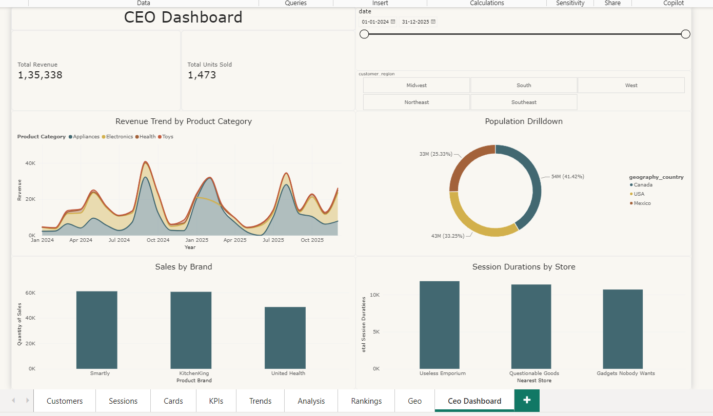
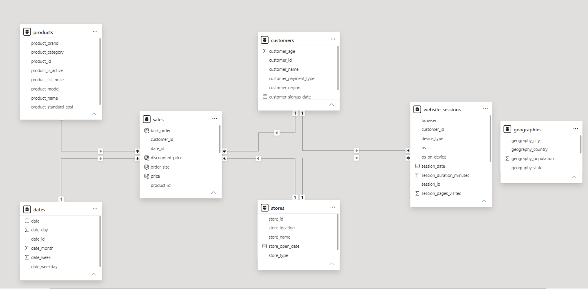

# Sales Performance Tracker

An independent Power BI portfolio project exploring sales performance, customer behaviour, website sessions, product performance and geographic context using a multi-page interactive report.

**Author:** Himanshu  
**Project type:** Independent learning and portfolio project  
**Tools:** Power BI Desktop, Power Query, DAX, CSV  
**Reporting period shown on the CEO dashboard:** 1 January 2024 – 31 December 2025  
**Currency displayed:** USD

## Dashboard preview



The report contains nine pages:

1. Customers
2. Sessions
3. Cards
4. KPIs
5. Trends
6. Analysis
7. Rankings
8. Geo
9. CEO Dashboard

The CEO Dashboard is the executive overview, with revenue and units-sold KPI cards, a date slicer, customer-region selection, a revenue trend by product category, a population breakdown, sales by brand and session duration by store.

## Project objectives

- Explore sales performance across the selected reporting period.
- Review sales trends by product category and brand.
- Present customer and website-session analysis.
- Provide KPI and ranking views to support business-oriented exploration.
- Use interactive report controls to navigate and filter the analysis.

## Data sources

The project uses seven CSV files:

| File | Role / contents |
|---|---|
| `sales.csv` | Sales transactions, date/customer/product/store keys, quantity and discount |
| `products.csv` | Product names, categories, brands, list prices, standard costs and active status |
| `customers.csv` | Customer names, age, payment type, region and signup date |
| `dates.csv` | Date dimension covering 2024–2025 |
| `stores.csv` | Store names, types, locations and opening dates |
| `website_sessions.csv` | Website sessions, customer/store keys, device/browser, purchase flag, duration, pages and quality score |
| `geographies.csv` | Country, state, city and population attributes |

The dataset was used as part of the following learning resource: [YouTube course/video reference](https://www.youtube.com/watch?v=keDIUQCVhtA&t=13019s). The project is presented as an independent learning/portfolio implementation. Dataset ownership and redistribution rights should be checked against the original course/source before making the CSV files public.

## Data preparation

The project notes indicate that Power Query was used to:
- Change data types.
- Remove duplicates.
- Handle missing values.

The report author also noted creating measures as required. Detailed step-by-step transformation descriptions can be added after reviewing the Applied Steps in Power Query.

## Data model

The model contains seven tables: `sales`, `products`, `customers`, `dates`, `stores`, `website_sessions` and `geographies`.

The semantic model relationship definitions show `sales` linked to `products`, `customers`, `dates` and `stores`. `website_sessions` is linked to `customers` and `stores`. The `geographies` table has no relationship defined in the supplied model; treat it as a disconnected table in the current model rather than assuming it filters other tables.



## DAX

The semantic model contains nine explicit measures and four calculated columns. The formulas and notes are documented separately:

- [DAX measures and calculated columns](DAX/DAX_Measures.md)

The extracted definitions include aggregation, iterator functions, `CALCULATE`, date filtering, `RELATED`, conditional logic and type conversion.

## Interactivity

The project uses:
- Slicers
- Drill-down
- Cross-filtering

## Repository structure

```text
Sales-Performance-Tracker/
├── Dashboard/
│   ├── eshopp.pbip
│   └── [Power BI report and semantic model folders]
├── Dataset/
│   ├── customers.csv
│   ├── dates.csv
│   ├── geographies.csv
│   ├── products.csv
│   ├── sales.csv
│   ├── stores.csv
│   └── website_sessions.csv
├── DAX/
│   └── DAX_Measures.md
├── Documentation/
│   └── Data_Model.png
├── Screenshots/
│   └── Main_Dashboard.png
├── Sales_Performance_Tracker_Report.pdf
└── README.md
```

## How to explore the report

1. Download or clone this repository.
2. Open the Power BI project (`.pbip`) in Power BI Desktop.
3. Keep the report and semantic model folders together with the project file.
4. If the CSV source paths need updating, edit the source paths in Power Query to point to the files in the `Dataset` folder, then refresh.
5. Explore the nine report pages and interact with slicers, drill-down and cross-filtering.

> Note: The project was authored locally in Power BI Desktop. A Power BI Pro subscription is not required to open and inspect the downloaded project in Power BI Desktop. Online sharing/public embedding is separate and is not required to use this repository.

## Current documentation notes

- The main dashboard screenshot displays Total Revenue of **$135,338** and Total Units Sold of **1,473** in the captured filter state. These are screenshot values, not a claim about every possible filter selection.
- No business findings have been supplied by the author yet. Add quantified findings only after validating them in the report under a clearly stated filter context.
- Review the DAX notes in `DAX/DAX_Measures.md` before presenting the calculations as final, especially the distinction between `total_revenue` and `discounted_revenue`.
- Do not publish customer-identifying or otherwise sensitive data. Confirm that the course dataset is synthetic/public and that its licence permits redistribution before committing raw CSVs.

## Author

**Himanshu** — Independent Power BI learning and portfolio project.
